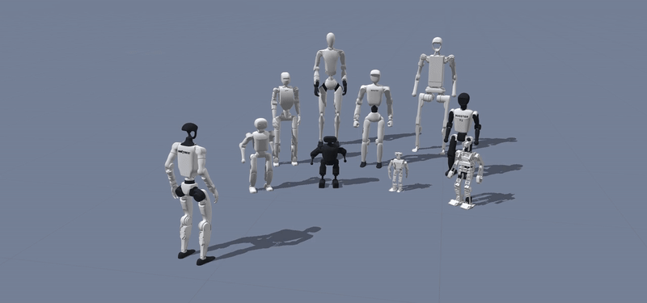
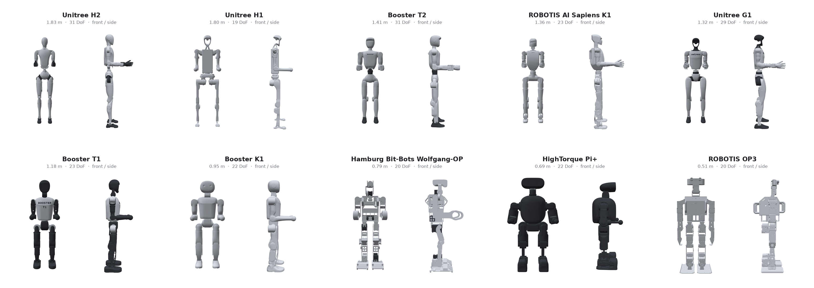

<div align="center">

# Robo-Retarget

**Robot-to-robot motion retargeting.**



</div>

Robo-Retarget transfers a motion recorded on one robot to another.

It builds on the IK of [GMR](https://github.com/YanjieZe/GMR), with another robot in place of
the human: the source motion is played through the source robot's forward kinematics, and the
target robot tracks the resulting keypoints. 

## Robots

| Name | Robot | Height | DoF | Model |
|---|---|---|---|---|
| `g1` | Unitree G1 | 1.3 m | 29 | GMR's `g1_mocap_29dof.xml` |
| `h1` | Unitree H1 | 1.8 m | 19 | MuJoCo Menagerie `unitree_h1` |
| `h2` | Unitree H2 | 1.84 m | 31 | `unitree_mujoco` `h2_mujoco.xml` |
| `ai_sapiens` | ROBOTIS AI Sapiens K1 | 1.36 m | 23 | ROBOTIS `ai_sapiens` `k1_rev2` |
| `k1` | Booster K1 | 0.95 m | 22 | `booster_assets` `K1_22dof.xml` |
| `t1` | Booster T1 | 1.2 m | 23 | `booster_assets` `T1_23dof.xml` |
| `t2` | Booster T2 | 1.4 m | 31 | `booster_assets` `T2_31dof.xml` |
| `op3` | ROBOTIS OP3 | 0.5 m | 20 | MuJoCo Menagerie `robotis_op3` |
| `pi_plus` | HighTorque Pi+ | 0.7 m | 22 | Hamburg Bit-Bots' `pi_plus.xml` |
| `wolfgang` | Bit-Bots Wolfgang-OP | 0.8 m | 20 | Hamburg Bit-Bots' `wolfgang_robot` URDF |

## Installation

```bash
git clone git@github.com:shinben0327/robo-retarget.git && cd robo-retarget
uv sync          # creates .venv (Python >= 3.10)
uv run pytest    # ~40 s, uses only the shipped assets
```

Rendering is offscreen through EGL and needs a GPU driver that supports it.

## Quickstart

```bash
# G1 dance -> K1, with a side-by-side video (source left, target right)
uv run robo-retarget --src g1 --tgt k1 --motion assets/motions/g1/dance_102.csv --fps 60 --render

# 10 s of a Booster T2 dance -> T1, saved as CSV, rendered in the white style
uv run robo-retarget --src t2 --tgt t1 --motion assets/motions/t2/t2_dance.csv \
    --start 200 --frames 500 --out outputs/t2_dance_t1.csv --render --style white
```

| Option | |
|---|---|
| `--src`, `--tgt` | robot names (directories in `assets/robots/`) |
| `--motion` | source motion, `.csv` or `.pkl` |
| `--out` | `.pkl` or `.csv` (default `outputs/<src>_to_<tgt>/<motion>.pkl`) |
| `--start`, `--frames` | a slice of the source motion |
| `--fps` | source frame rate, when the file does not carry it |
| `--render` | side-by-side mp4 next to the output; `--hq` for 2x supersampling (~4x slower), `--style studio\|white\|stage\|daylight\|night\|slate` |

From Python:

```python
from robo_retarget import Robot, load_motion, retarget, save_motion

g1, k1 = Robot("g1"), Robot("k1")
motion = load_motion("assets/motions/g1/dance_102.csv", g1, fps=60)
save_motion("dance_k1.pkl", retarget(motion, g1, k1), k1)
```

### Motion formats

- **`.csv`**: one row per frame: root position `x y z`, root quaternion `qx qy qz qw`, joint
  angles. This is the layout of Unitree's and Booster's motion files. The joint order is taken
  from the header row if there is one, otherwise from `csv.joints` in `robot.json`; the frame
  rate from `--fps`, otherwise from `csv.fps`.
- **`.pkl`**: GMR's layout (`fps`, `root_pos`, `root_rot` as xyzw, `dof_pos` in MJCF order),
  plus `joint_names`, `robot` and the source robot, file and start frame.

## How it works

Every robot is described by its MJCF and a `robot.json`, which maps 15 canonical keypoints
(pelvis, torso, head, and left/right hip, knee, foot, upper arm, forearm, hand) to the robot's
bodies and defines a common **rest pose**: upper arms down, forearms forward, legs straight,
feet on the floor.



Since both skeletons are known exactly, the GMR IK config for a robot pair is **computed** from
the two rest poses. For each keypoint:

- **rotation offset**: the relative rotation of the two links at rest;
- **scale**: the ratio of their distances from the pelvis (for the pelvis, the height ratio);
- **position offset**: whatever residual is left at rest after scaling.

## Adding a robot

1. Add `assets/robots/<name>/` with an MJCF whose root body has a free joint and its meshes. 
   A URDF converts with [`tools/urdf_to_mjcf.py`](tools/urdf_to_mjcf.py).
2. Copy a `robot.json` from another robot, map the keypoints to bodies and choose rest joint
   angles that match the common rest pose.
3. Compare it with the others: `uv run python tools/render_rest_poses.py <name> g1`.
4. `uv run pytest -k <name>` checks that every pair maps rest pose to rest pose, and that
   retargeting the robot onto itself reproduces its motion.

## Sample motions

`assets/motions/` holds a few clips per robot for trying things out:

| Robot | Clips | fps | Source | Licence |
|---|---|---|---|---|
| G1 | `dance_102`, `gangnam_style` | 60 | [unitree_rl_lab](https://github.com/unitreerobotics/unitree_rl_lab) | Apache-2.0 |
| G1 | `dance1_subject2`, `fight1_subject2`, `jumps1_subject1`, `walk1_subject1` | 30 | Unitree's LAFAN1 retargeting dataset | CC BY-NC-ND 4.0 |
| H1 | `walk1_subject1` | 30 | Unitree's LAFAN1 retargeting dataset | CC BY-NC-ND 4.0 |
| K1, T1, T2 | Booster's demo motions | 50 | [booster_assets](https://github.com/BoosterRobotics/booster_assets) | BSD-3-Clause |

The LAFAN1 clips are non-commercial and no-derivatives: motions retargeted from them are for
your own non-commercial use and should not be redistributed.

## Tools

| | |
|---|---|
| [`tools/render_samples.sh`](tools/render_samples.sh) | retarget and render a set of sample pairs into `outputs/samples/` |
| [`tools/render_hero.py`](tools/render_hero.py) | the header animation: one G1 clip on all ten robots in one scene |
| [`tools/render_rest_poses.py`](tools/render_rest_poses.py) | the rest-pose figure, or a check of one robot |
| [`tools/add_hand_tips.py`](tools/add_hand_tips.py) | hand keypoint bodies for robots without a hand link |
| [`tools/decimate_meshes.py`](tools/decimate_meshes.py) | shrink oversized CAD meshes (and convert them to STL) |
| [`tools/urdf_to_mjcf.py`](tools/urdf_to_mjcf.py) | convert a URDF into an MJCF robo-retarget can load |

```
robo_retarget/
├── robots.py     Robot: MJCF + robot.json, forward kinematics, rest pose, ground height
├── motion.py     Motion; CSV / pkl loading and saving
├── retarget.py   per-pair IK config from the rest poses; the retargeting loop
├── render.py     offscreen renders and side-by-side videos
├── cli.py        the robo-retarget command
└── gmr/          vendored GMR IK solver (MIT); its README lists the changes
assets/
├── robots/<name>/    MJCF, meshes, robot.json, licence
└── motions/<name>/   sample motions
```

## Acknowledgements

robo-retarget stands on [GMR](https://github.com/YanjieZe/GMR) for its IK and on
[hoi-retarget](https://github.com/leggedrobotics/hoi-retarget) for its render style. Robot
models come from [Unitree](https://github.com/unitreerobotics),
[Booster Robotics](https://github.com/BoosterRobotics/booster_assets),
[MuJoCo Menagerie](https://github.com/google-deepmind/mujoco_menagerie),
[ROBOTIS](https://github.com/ROBOTIS-GIT/ai_sapiens) and the
[Hamburg Bit-Bots](https://github.com/bit-bots).

## Licence

MIT, Copyright (c) 2026 Jihwan Shin. Bundled third-party material keeps its own licence:
`robo_retarget/gmr/` is MIT (GMR) and `robo_retarget/render.py` BSD-3-Clause (adapted from
hoi-retarget); the robot models are BSD-3-Clause (Unitree, Booster Robotics), Apache-2.0 (OP3,
AI Sapiens K1) and MIT (Pi+, Wolfgang-OP); the sample motions are licensed as listed above. See
[`THIRD_PARTY_NOTICES.md`](THIRD_PARTY_NOTICES.md).
